# Лабораторная работа № 1. Введение в виртуальные машины и установка Debian

Студент: Мещанинов А.А.
Группа: ИС-25

## Цель работы

Установить VirtualBox, создать виртуальную машину с Debian, настроить сеть (NAT и Bridged), обновить систему и настроить доступ по SSH по паролю и по ключу.

## Используемые средства

| Компонент   | Версия                       |
| ----------- | ---------------------------- |
| Компьютер   | MacBook (процессор Apple M4) |
| Гипервизор  | VirtualBox 7.2               |
| Гостевая ОС | Debian 13 «Trixie», arm64    |

> На Mac с процессором M4 используется образ Debian для архитектуры **arm64** — обычный образ amd64 на таком процессоре не запускается.

---

## Задание 1. Установка виртуальной машины

VirtualBox скачан с официального сайта [virtualbox.org](https://www.virtualbox.org/) (версия для macOS / Apple Silicon) и установлен.

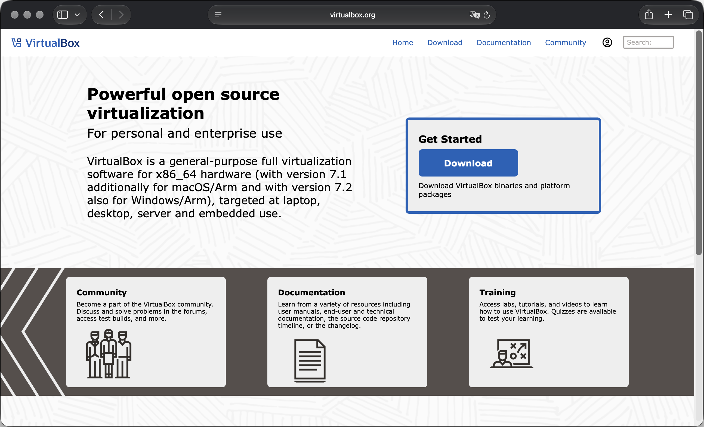

Образ `debian-13.7.0-arm64-netinst.iso` скачан с сайта Debian.

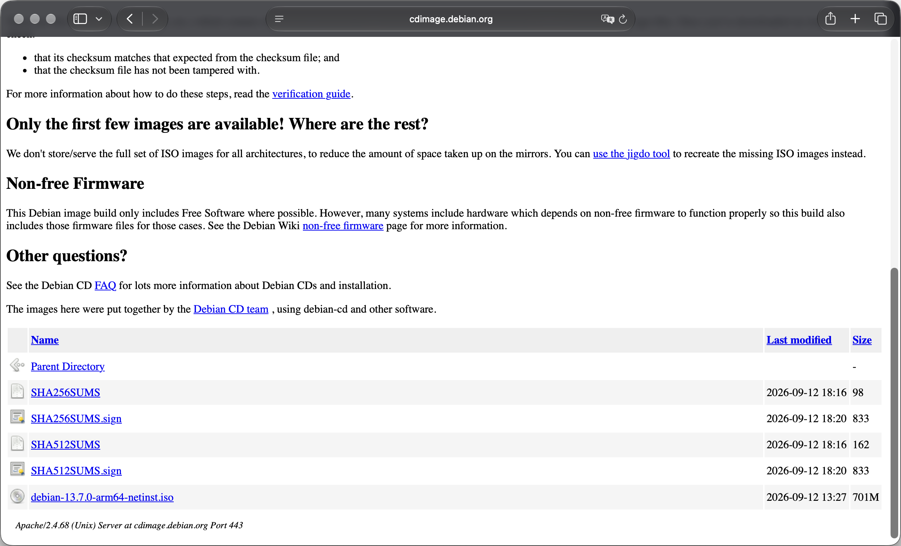

Создана виртуальная машина `debian-server`: 4096 МБ оперативной памяти, 2 процессора, диск 20 ГБ.

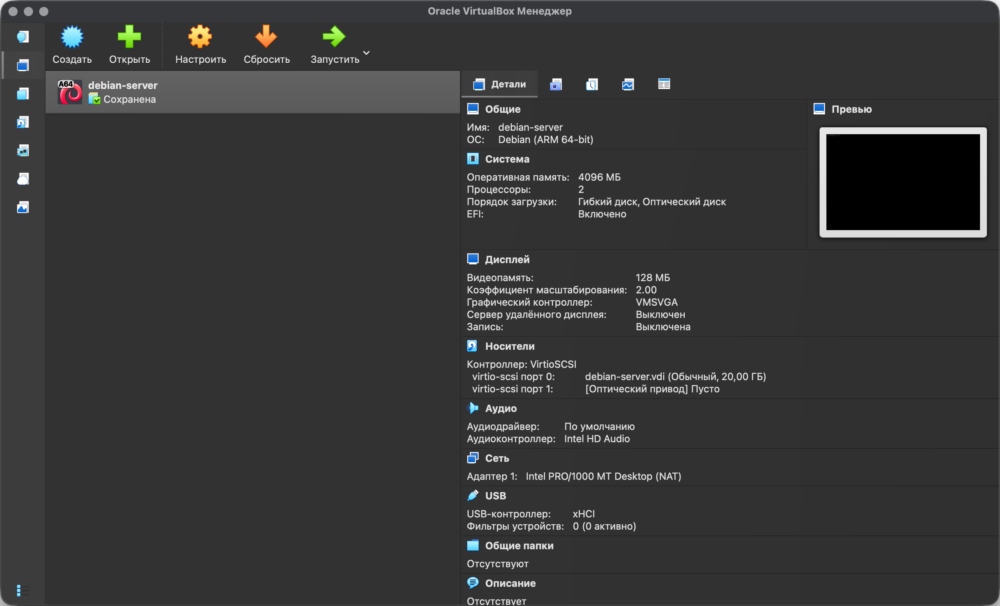

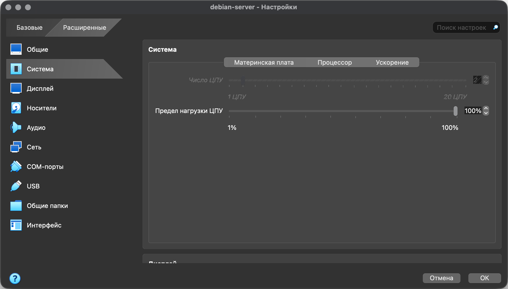

---

## Задание 2. Установка Debian

Debian установлен вручную. При установке заданы:

- язык — русский, часовой пояс — Москва;
- имя компьютера — `debian`;
- пользователь — `user`; пароль root не задавался, поэтому команды администратора выполняются через `sudo`;
- программы — SSH-сервер и стандартные утилиты.

После установки система загрузилась:

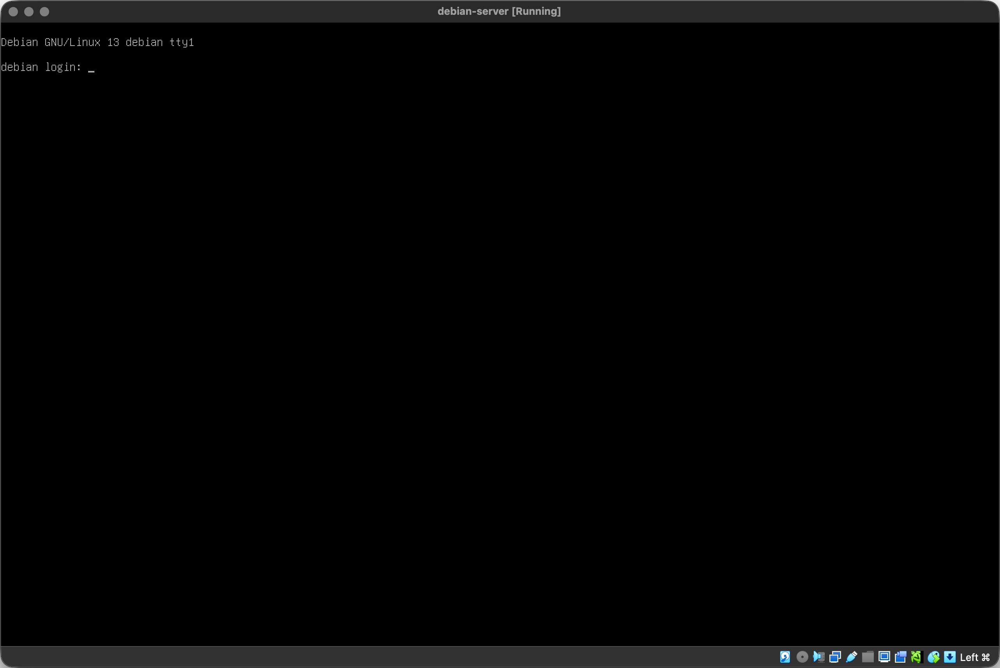

Проверка системы:

```bash
hostnamectl
timedatectl
ip -br a
lsblk
```

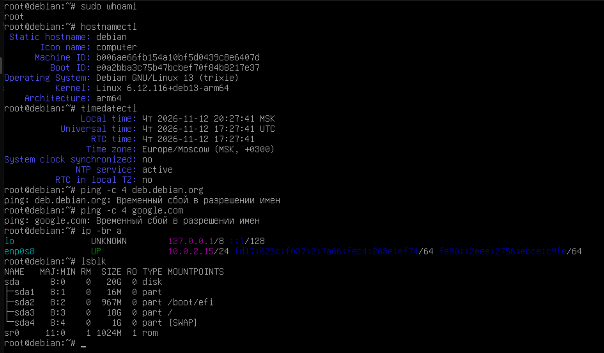

---

## Задание 3. Настройка сети и обновление системы

### Режим NAT

Для сетевого адаптера выбран режим NAT. Виртуальная машина выходит в интернет через компьютер и получает адрес `10.0.2.15`.

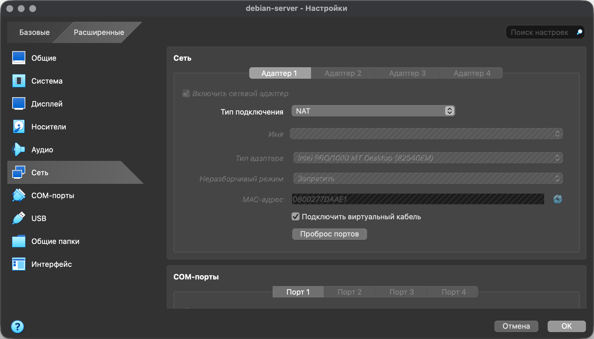

### Проблема с DNS

После установки интернет не работал: `apt-get update` выдавал ошибку «Временный сбой в разрешении имён», то есть не работал DNS.

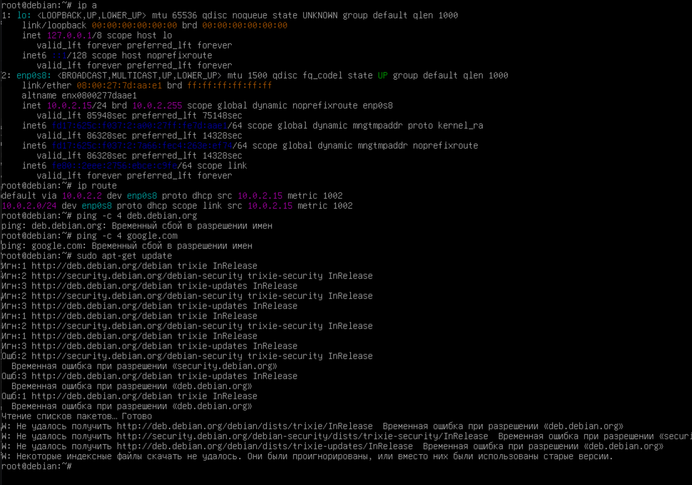

В файле `/etc/resolv.conf` был указан DNS-сервер VirtualBox, который не отвечал. Вместо него указан DNS Google `8.8.8.8`, после этого обновление заработало:

```bash
echo "nameserver 8.8.8.8" > /etc/resolv.conf
apt-get update
```

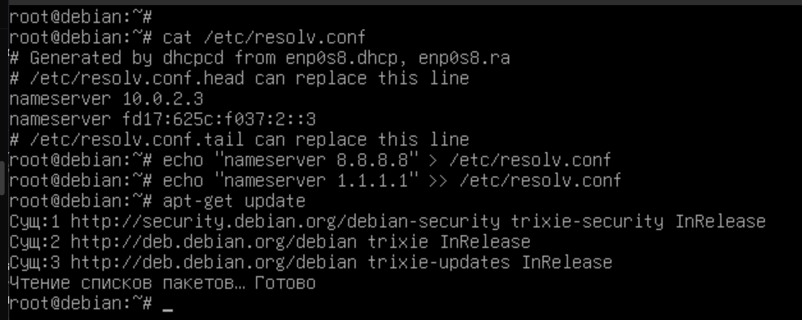

После перезагрузки настройка пропала: файл перезаписывается программой `dhcpcd`.

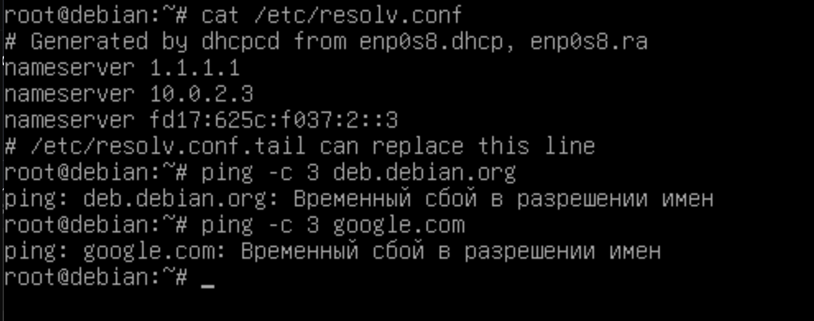

Чтобы настройка сохранялась, `dhcpcd` запрещено менять этот файл:

```bash
echo "nohook resolv.conf" >> /etc/dhcpcd.conf
echo "nameserver 8.8.8.8" > /etc/resolv.conf
echo "nameserver 8.8.4.4" >> /etc/resolv.conf
reboot
```

После перезагрузки DNS работает — имя `deb.debian.org` определилось. Сам `ping` не проходит, потому что VirtualBox на Mac не пропускает ping наружу, но интернет работает (видно по обновлению ниже).

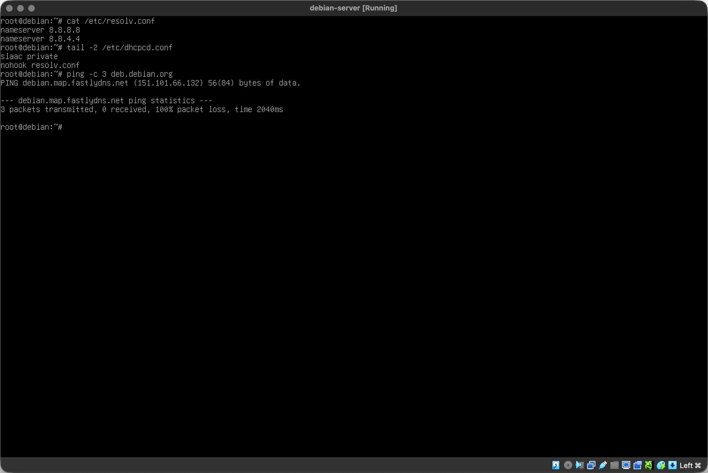

### Режим Bridged

В режиме «Сетевой мост» виртуальная машина подключается к той же сети, что и ноутбук, и получает адрес от роутера. Для работы выбран NAT, так как ноутбук подключается к разным сетям Wi-Fi.

### Обновление системы

```bash
apt-get update
apt-get upgrade -y
```

`update` обновляет список пакетов, `upgrade` устанавливает обновления. Система уже была обновлена, поэтому обновлять было нечего.

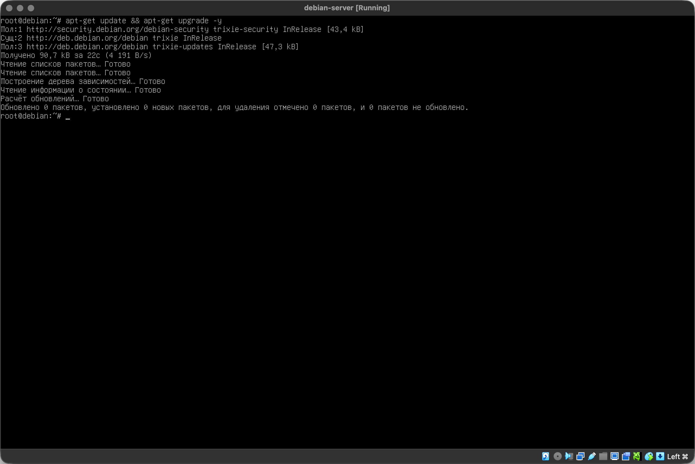

---

## Задание 4. Настройка SSH

SSH-сервер установлен при установке системы и работает:

```bash
systemctl status ssh
```

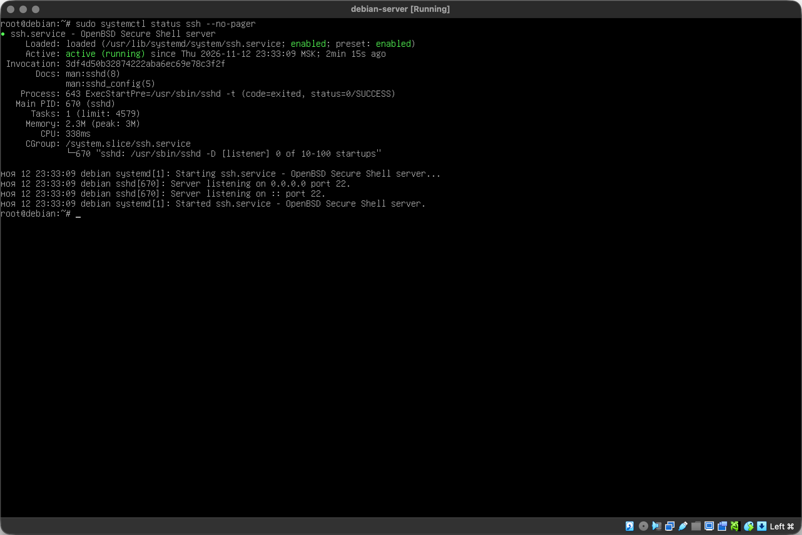

В режиме NAT к виртуальной машине нельзя подключиться напрямую, поэтому настроен проброс портов: порт 22 компьютера → порт 22 виртуальной машины.

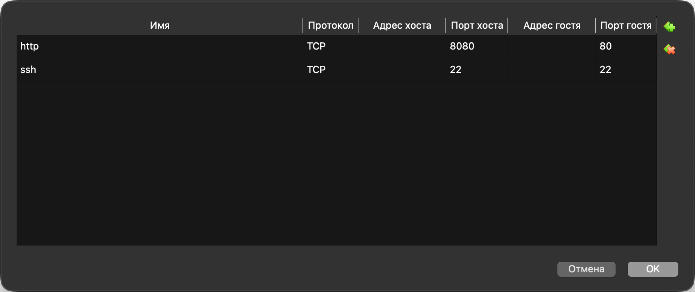

### Вход по паролю и создание ключа

На Mac создан SSH-ключ и скопирован на виртуальную машину. Команда `ssh-copy-id` запросила пароль пользователя — это и есть вход по паролю:

```bash
ssh-keygen -t ed25519
ssh-copy-id -i ~/.ssh/id_ed25519.pub -p 22 user@127.0.0.1
```

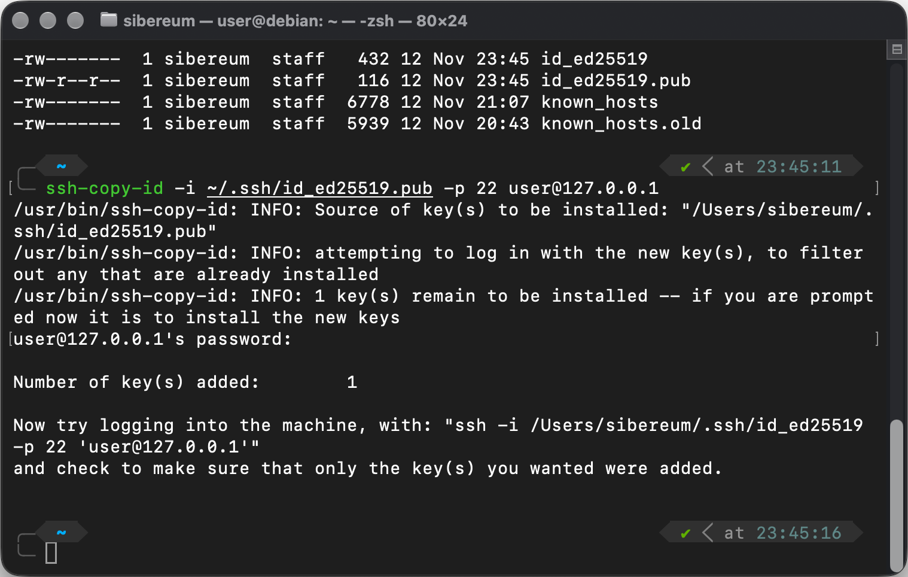

### Вход по ключу

Теперь подключение выполняется без пароля:

```bash
ssh -p 22 user@127.0.0.1
```

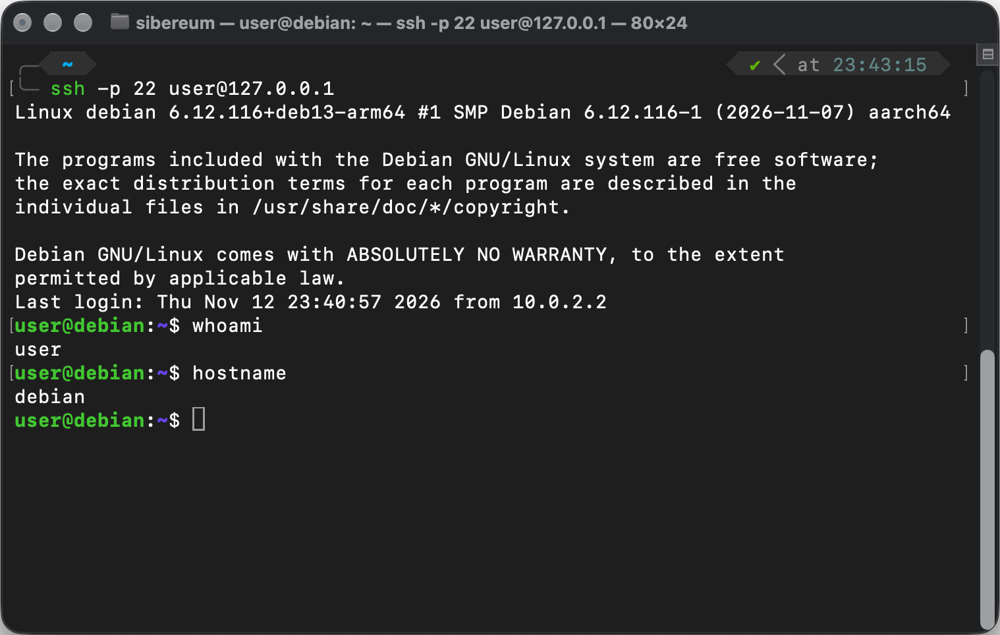

---

## Вывод

Установлен VirtualBox, создана виртуальная машина и установлен Debian 13. Настроена сеть в режиме NAT, исправлена проблема с DNS, система обновлена. Настроен доступ по SSH с компьютера по паролю и по ключу.
