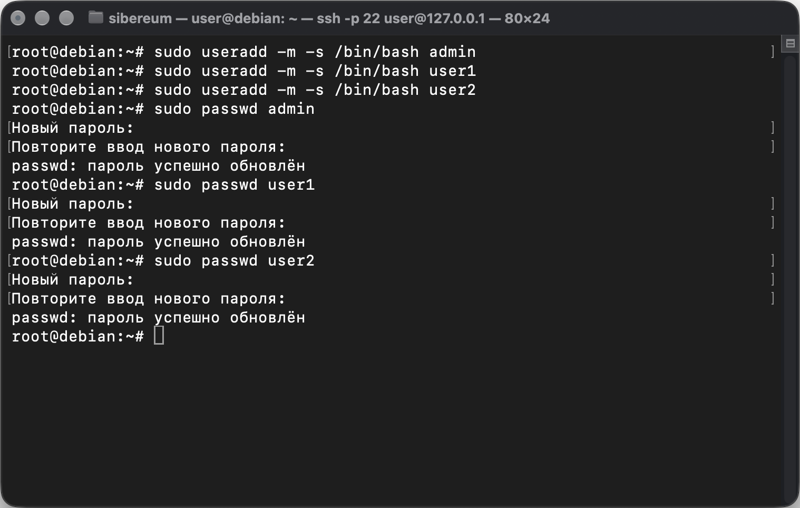
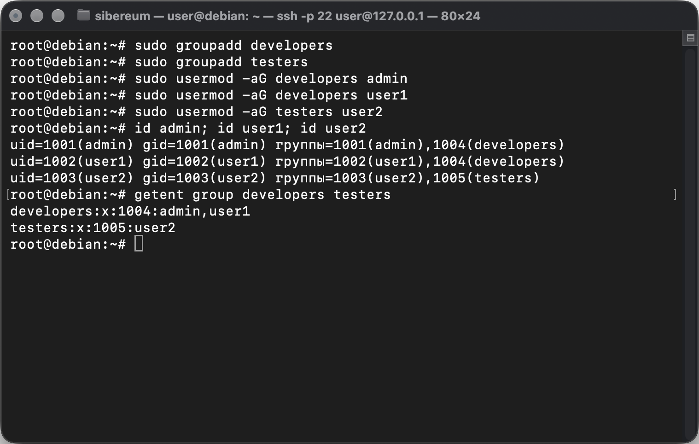
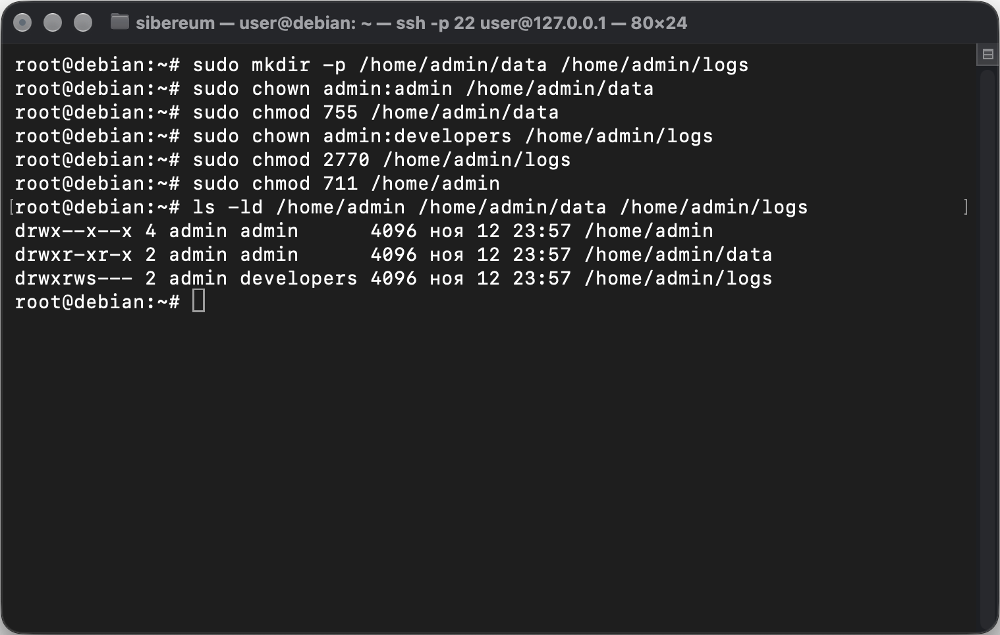
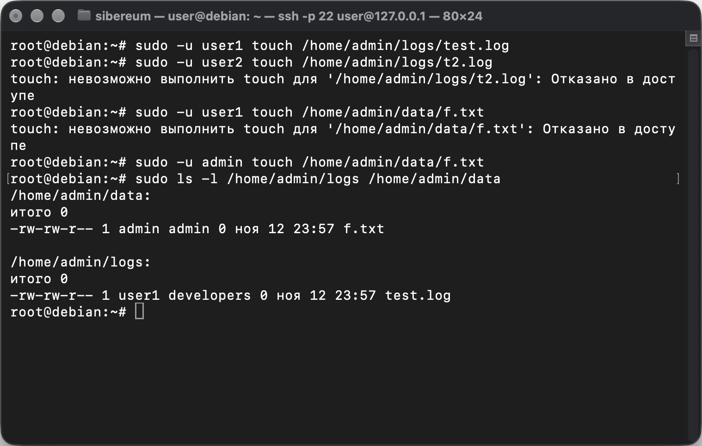
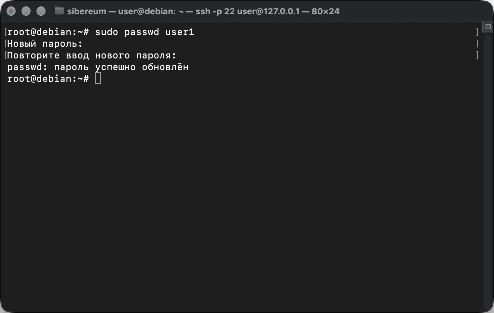
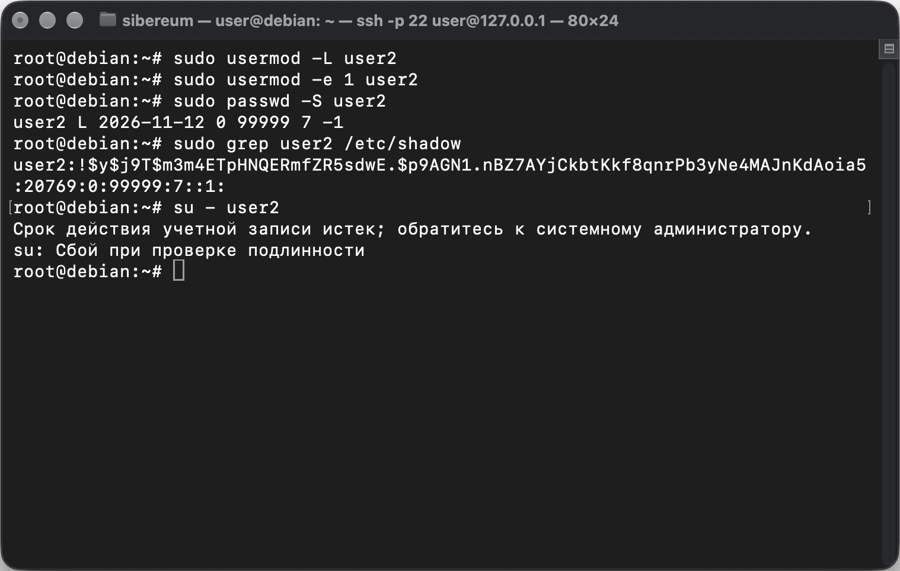
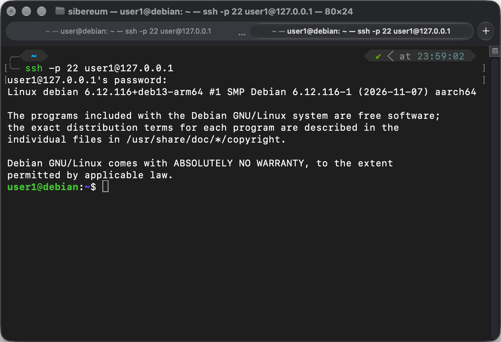
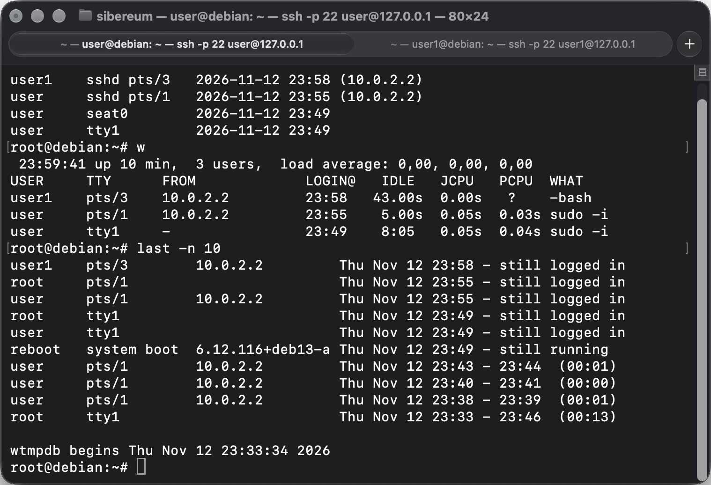
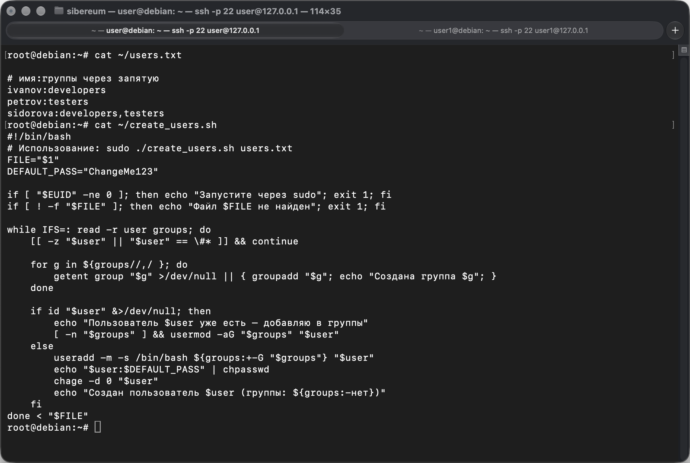
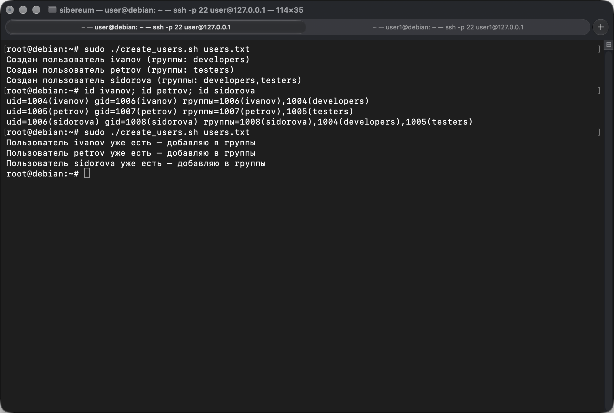

# Лабораторная работа № 2. Управление системой и пользователями

Студент: Мещанинов Артём Александрович
Группа: ИС-25

## Цель работы

Изучить управление пользователями и группами в Debian, настройку прав доступа к файлам и каталогам, команды мониторинга активности пользователей и автоматизировать создание учётных записей с помощью bash-скрипта.

## Используемые средства

| Компонент    | Версия                                                                                              |
| ------------ | --------------------------------------------------------------------------------------------------- |
| Хост-система | macOS, Apple M4                                                                                     |
| Гипервизор   | Oracle VirtualBox 7.2                                                                               |
| Гостевая ОС  | Debian GNU/Linux 13 «Trixie», arm64                                                                 |
| Доступ к ВМ  | SSH из Терминала macOS (`ssh -p 22 user@127.0.0.1`), команды выполнялись в консоли root (`sudo -i`) |

---

## 1. Создание пользователей и групп

Созданы пользователи `admin`, `user1`, `user2`. Опция `-m` создаёт домашний каталог, `-s /bin/bash` задаёт командную оболочку. Пароли заданы командой `passwd`.

```bash
sudo useradd -m -s /bin/bash admin
sudo useradd -m -s /bin/bash user1
sudo useradd -m -s /bin/bash user2

sudo passwd admin
sudo passwd user1
sudo passwd user2
```



Созданы группы `developers` и `testers`. Пользователи распределены так: `admin` и `user1` — в developers, `user2` — в testers. Флаг `-a` в `usermod -aG` обязателен: без него пользователь будет удалён из всех остальных дополнительных групп.

```bash
sudo groupadd developers
sudo groupadd testers

sudo usermod -aG developers admin
sudo usermod -aG developers user1
sudo usermod -aG testers user2

id admin; id user1; id user2
getent group developers testers
```



---

## 2. Настройка прав доступа

```bash
sudo mkdir -p /home/admin/data /home/admin/logs

# data: изменять файлы может только admin, остальные — только читать
sudo chown admin:admin /home/admin/data
sudo chmod 755 /home/admin/data

# logs: группа developers читает и пишет, остальным доступ закрыт
sudo chown admin:developers /home/admin/logs
sudo chmod 2770 /home/admin/logs

# домашний каталог: в Debian 13 создаётся с правами 700,
# другие пользователи не смогут даже пройти к logs — даём только право прохода (x)
sudo chmod 711 /home/admin

ls -ld /home/admin /home/admin/data /home/admin/logs
```

| Каталог            | Владелец:группа  | Права                | Смысл                                                                                |
| ------------------ | ---------------- | -------------------- | ------------------------------------------------------------------------------------ |
| `/home/admin`      | admin:admin      | `711` (`rwx--x--x`)  | остальные могут пройти внутрь, но не видят список файлов                             |
| `/home/admin/data` | admin:admin      | `755` (`rwxr-xr-x`)  | писать может только admin                                                            |
| `/home/admin/logs` | admin:developers | `2770` (`rwxrws---`) | developers читают и пишут; бит setgid (`s`) — новые файлы получают группу developers |



Проверка доступа от имени разных пользователей:

```bash
sudo -u user1 touch /home/admin/logs/test.log   # успех — user1 в группе developers
sudo -u user2 touch /home/admin/logs/t2.log     # Permission denied — user2 не в developers
sudo -u user1 touch /home/admin/data/f.txt      # Permission denied — писать может только admin
sudo -u admin touch /home/admin/data/f.txt      # успех
ls -l /home/admin/logs                          # у test.log группа developers (setgid)
```



---

## 3. Команды управления пользователями

| Команда    | Назначение                                                                                                          | Пример                                    |
| ---------- | ------------------------------------------------------------------------------------------------------------------- | ----------------------------------------- |
| `useradd`  | создать пользователя (`-m` — домашний каталог, `-s` — оболочка, `-G` — группы)                                      | `useradd -m -s /bin/bash -G testers ivan` |
| `usermod`  | изменить учётную запись (`-aG` — добавить в группу, `-L`/`-U` — заблокировать/разблокировать, `-e` — срок действия) | `usermod -aG developers user1`            |
| `groupadd` | создать группу                                                                                                      | `groupadd testers`                        |
| `passwd`   | сменить пароль (`-l`/`-u` — блокировка, `-S` — статус)                                                              | `passwd user1`                            |
| `chown`    | сменить владельца и группу файла (`-R` — рекурсивно)                                                                | `chown admin:developers logs`             |
| `chmod`    | сменить права: числом (r=4, w=2, x=1 для владельца, группы, остальных) или символами (`u+x`, `go-w`)                | `chmod 750 dir`                           |

Смена пароля пользователя `user1`:

```bash
sudo passwd user1
```



Блокировка учётной записи `user2`:

```bash
sudo usermod -L user2         # блокировка пароля: перед хешем в /etc/shadow ставится «!»
sudo usermod -e 1 user2       # срок действия учётной записи истёк — запрещает вход и по SSH-ключу
sudo passwd -S user2          # статус: L — locked
sudo grep user2 /etc/shadow
su - user2                    # отказ во входе
```

`passwd -S` показывает статус `L` (locked), в `/etc/shadow` перед хешем пароля появился символ `!`, а `su - user2` завершается сообщением «Срок действия учетной записи истек» и «Сбой при проверке подлинности». `usermod -L` блокирует только вход по паролю. Чтобы пользователь не вошёл и по SSH-ключу, дополнительно выставлен истёкший срок действия учётной записи (`-e 1`). Разблокировка: `sudo usermod -U -e "" user2`.



---

## 4. Мониторинг активности пользователей

Для наглядности во второй вкладке Терминала macOS открыта SSH-сессия от имени `user1` (`ssh -p 22 user1@127.0.0.1`) с новым паролем:



| Команда | Что показывает                                                                                           | Примеры                                   |
| ------- | -------------------------------------------------------------------------------------------------------- | ----------------------------------------- |
| `who`   | кто сейчас в системе: имя, терминал (`tty` — локальная консоль, `pts/N` — SSH), время входа, адрес       | `who`, `who -b` (время загрузки)          |
| `w`     | то же, плюс время работы системы, load average, время бездействия и текущая команда каждого пользователя | `w`, `w user1`                            |
| `last`  | история входов и перезагрузок: кто, откуда, когда, сколько длилась сессия                                | `last -n 10`, `last user1`, `last reboot` |

```bash
who
who -b
w
last -n 10
last user1
last reboot
```

В выводе видны три сеанса: `user1` и `user` по SSH (терминалы `pts/3`, `pts/1`, адрес `10.0.2.2` — это Mac за NAT) и `user` в локальной консоли `tty1`. `w` дополнительно показывает время работы системы (`up 10 min`), load average, время бездействия и текущую команду (`-bash`, `sudo -i`). `last` выводит историю входов с длительностью сеансов и запись о загрузке системы (`reboot system boot`). В Debian 13 команда `last` входит в пакет `wtmpdb`, отсюда строка `wtmpdb begins` в конце вывода.



---

## 5. Автоматизация управления пользователями

Файл `users.txt` со списком пользователей в формате `имя:группа1,группа2`:

```
# имя:группы через запятую
ivanov:developers
petrov:testers
sidorova:developers,testers
```

Скрипт `create_users.sh`:

```bash
#!/bin/bash
# Использование: sudo ./create_users.sh users.txt
FILE="$1"
DEFAULT_PASS="ChangeMe123"

if [ "$EUID" -ne 0 ]; then echo "Запустите через sudo"; exit 1; fi
if [ ! -f "$FILE" ]; then echo "Файл $FILE не найден"; exit 1; fi

while IFS=: read -r user groups; do
    [[ -z "$user" || "$user" == \#* ]] && continue      # пропуск пустых строк и комментариев

    for g in ${groups//,/ }; do                           # создать недостающие группы
        getent group "$g" >/dev/null || { groupadd "$g"; echo "Создана группа $g"; }
    done

    if id "$user" &>/dev/null; then
        echo "Пользователь $user уже есть — добавляю в группы"
        [ -n "$groups" ] && usermod -aG "$groups" "$user"
    else
        useradd -m -s /bin/bash ${groups:+-G "$groups"} "$user"
        echo "$user:$DEFAULT_PASS" | chpasswd             # временный пароль
        chage -d 0 "$user"                                # смена пароля при первом входе
        echo "Создан пользователь $user (группы: ${groups:-нет})"
    fi
done < "$FILE"
```

Алгоритм работы:

1. Проверяет, что скрипт запущен от root и что файл существует.
2. Построчно читает файл, разделяя строку по `:` на имя и список групп; пустые строки и комментарии пропускаются.
3. Создаёт группы, которых ещё нет (`getent group` → `groupadd`).
4. Если пользователь уже существует — добавляет его в группы; иначе создаёт с домашним каталогом, задаёт временный пароль и требует сменить его при первом входе.

Повторный запуск ничего не ломает: существующие пользователи и группы не создаются заново.



```bash
chmod +x create_users.sh
sudo ./create_users.sh users.txt
id ivanov; id petrov; id sidorova
sudo ./create_users.sh users.txt     # повторный запуск
```

При первом запуске созданы пользователи `ivanov`, `petrov`, `sidorova` с нужными группами (проверено командой `id`), при повторном — скрипт сообщает, что пользователи уже есть.



---

## Вывод

Созданы пользователи `admin`, `user1`, `user2` и группы `developers`, `testers`. Настроены права доступа: каталог `data` доступен на запись только `admin`, каталог `logs` — группе `developers`; использован бит setgid для наследования группы и право прохода `711` на домашний каталог. Изучены команды `useradd`, `usermod`, `groupadd`, `passwd`, `chown`, `chmod`; изменён пароль `user1`, заблокирована учётная запись `user2` (включая вход по ключу). Рассмотрены команды мониторинга `who`, `w`, `last`. Написан bash-скрипт, создающий пользователей и группы из текстового файла.
