# Лабораторная работа № 3. Управление пакетами, системными сервисами и настройка сети

Студент: Мещанинов Артём Александрович
Группа: ИС-25

## Цель работы

Научиться настраивать источники пакетов APT и устанавливать программы, управлять системными службами через systemd, планировать задачи с помощью cron, настраивать статический IP-адрес и диагностировать сеть стандартными утилитами.

## Используемые средства

| Компонент            | Версия                                 |
| -------------------- | -------------------------------------- |
| Хост-система         | macOS, Apple M4                        |
| Гипервизор           | Oracle VirtualBox 7.2, адаптер 1 — NAT |
| Гостевая ОС          | Debian GNU/Linux 13 «Trixie», arm64    |
| Сетевой интерфейс ВМ | `enp0s8`                               |

---

## 1. Управление пакетами

### 1.1. Настройка /etc/apt/sources.list

Кодовое имя версии — `trixie` (`cat /etc/os-release`). Сделана резервная копия, файл отредактирован:

```bash
sudo cp /etc/apt/sources.list /etc/apt/sources.list.bak
sudo nano /etc/apt/sources.list
```

```
# Официальные репозитории Debian
deb http://deb.debian.org/debian trixie main contrib non-free non-free-firmware
deb http://deb.debian.org/debian trixie-updates main contrib non-free non-free-firmware
deb http://security.debian.org/debian-security trixie-security main contrib non-free non-free-firmware

# Зеркало (Россия)
deb http://mirror.yandex.ru/debian trixie main contrib non-free non-free-firmware
```

Структура строки: тип (`deb` — двоичные пакеты), адрес репозитория, выпуск (`trixie`, `trixie-updates`, `trixie-security`), разделы (`main` — свободное ПО, `contrib` — свободное с несвободными зависимостями, `non-free` и `non-free-firmware` — несвободное ПО и прошивки). Зеркало — копия официального репозитория, расположенная ближе для ускорения загрузки.

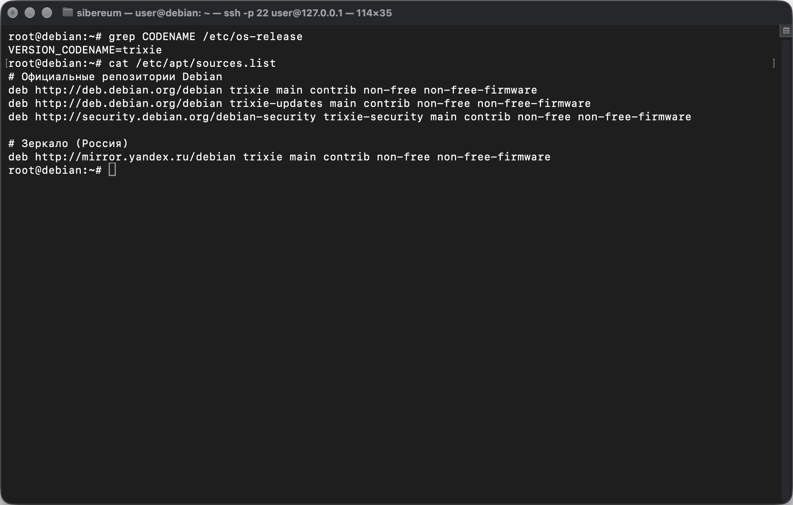

```bash
sudo apt update
```

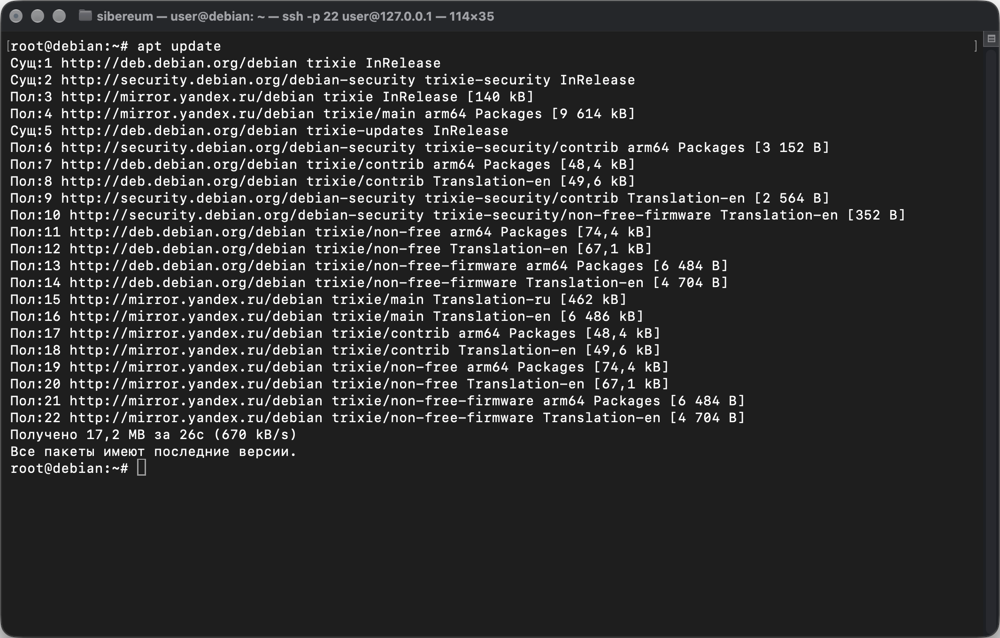

### 1.2. Установка пакетов

```bash
sudo apt install -y vim curl net-tools apache2
```

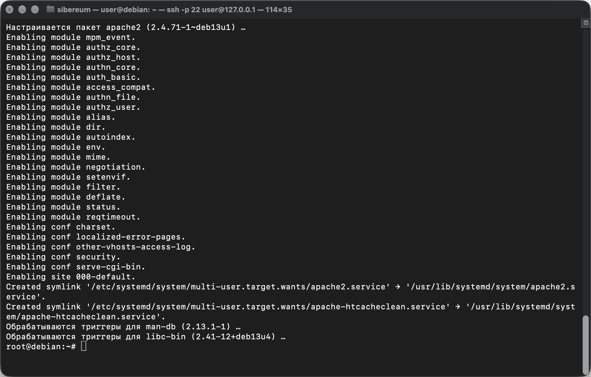

### 1.3. Скрипт установки пакетов

Скрипт `install_packages.sh`:

```bash
#!/bin/bash
# Использование: sudo ./install_packages.sh
PACKAGES="vim curl net-tools apache2"

if [ "$EUID" -ne 0 ]; then echo "Запустите через sudo"; exit 1; fi

apt-get update
for pkg in $PACKAGES; do
    if dpkg -s "$pkg" &>/dev/null; then
        echo "$pkg уже установлен"
    else
        apt-get install -y "$pkg" && echo "$pkg установлен" || echo "ОШИБКА: $pkg"
    fi
done
```

Скрипт проверяет права root, обновляет списки пакетов и для каждого пакета проверяет через `dpkg -s`, установлен ли он; отсутствующие устанавливает. Для демонстрации предварительно удалён пакет `vim`:

```bash
sudo apt remove -y vim
chmod +x install_packages.sh
sudo ./install_packages.sh
```

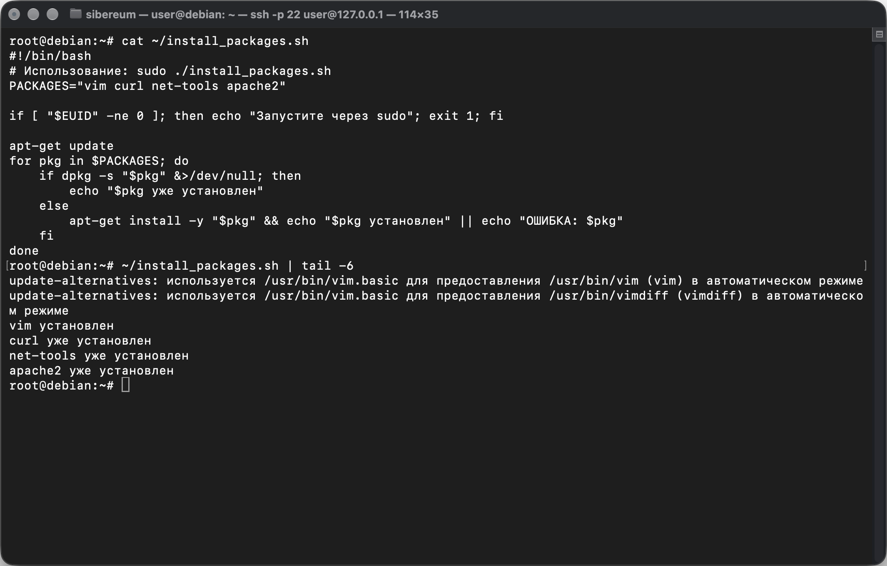

Проверка Apache: на ВМ `curl -I http://localhost` возвращает `HTTP/1.1 200 OK`; на Mac в браузере по адресу `http://127.0.0.1:8080` (проброс порта 8080 → 80) открывается стандартная страница Apache.

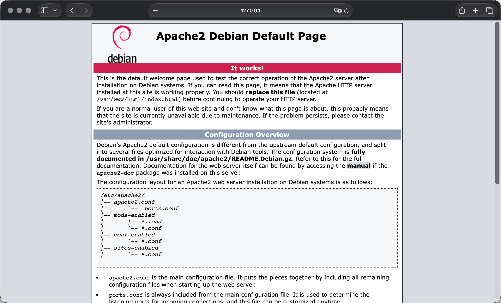

---

## 2. Системные сервисы

### 2.1. Автозапуск и управление службами

```bash
sudo systemctl enable apache2 ssh       # включить автозапуск при загрузке
systemctl is-enabled apache2 ssh        # enabled, enabled

sudo systemctl status apache2           # состояние и последние строки журнала
sudo systemctl stop apache2;    systemctl is-active apache2    # inactive
sudo systemctl start apache2;   systemctl is-active apache2    # active
sudo systemctl restart apache2
sudo systemctl disable apache2; systemctl is-enabled apache2   # disabled
sudo systemctl enable --now apache2                            # включить и сразу запустить
```

`start`/`stop` действуют сейчас, `enable`/`disable` — на автозапуск при следующих загрузках; `enable --now` делает и то, и другое.

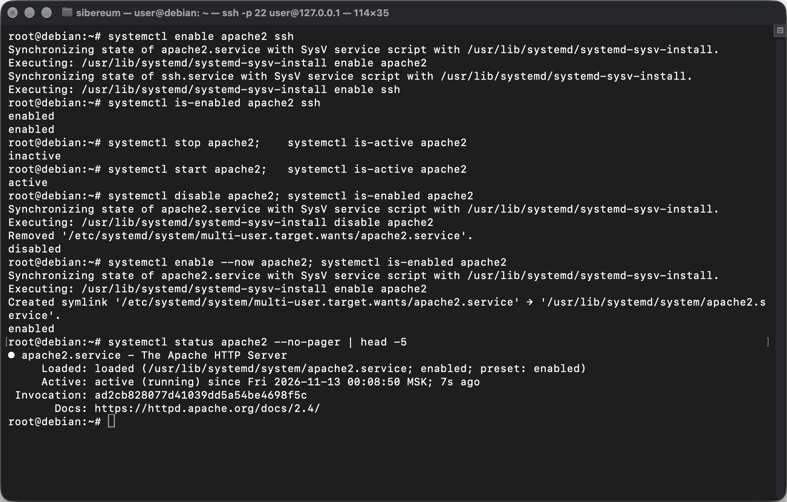

### 2.2. Ежедневный перезапуск Apache через cron

```bash
sudo crontab -e
```

Добавлена строка — перезапуск каждый день в 04:00:

```
0 4 * * * /usr/bin/systemctl restart apache2
```

Поля: минута, час, день месяца, месяц, день недели. В cron используется полный путь к команде, так как переменная `PATH` в cron урезана.

```bash
sudo crontab -l
```

Для проверки расписание временно заменено на `*/2 * * * *` (каждые 2 минуты): время в строке `Active: active (running) since` вывода `systemctl status apache2` обновилось, после чего возвращено ежедневное расписание.

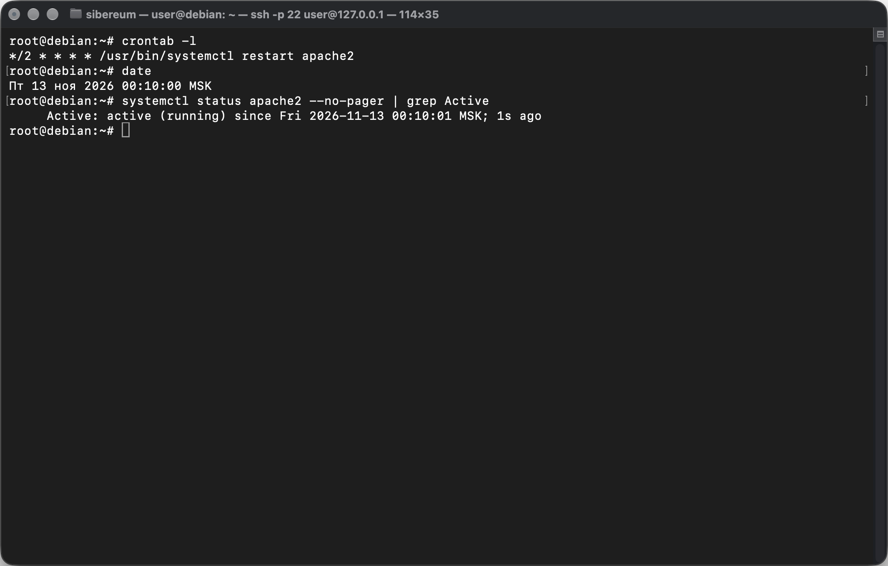

---

## 3. Конфигурация сети

### 3.1. Исходное состояние

До настройки адрес выдавался по DHCP:

```bash
ip a
ip route
cat /etc/network/interfaces
```

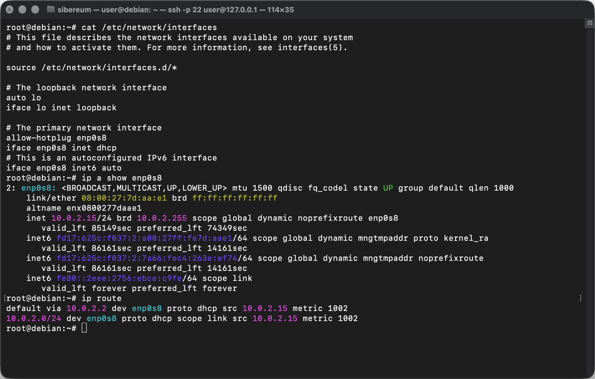

### 3.2. Статический IP-адрес

Настройка выполнялась в окне ВМ (не по SSH), так как при перезапуске сети SSH-соединение обрывается.

```bash
sudo cp /etc/network/interfaces /etc/network/interfaces.bak
sudo nano /etc/network/interfaces
```

```
auto lo
iface lo inet loopback

auto enp0s8
iface enp0s8 inet static
    address 10.0.2.15/24
    gateway 10.0.2.2
```

- `auto` — поднимать интерфейс при загрузке;
- `inet static` — статический адрес вместо `inet dhcp`;
- `address` — IP-адрес с маской (`/24` = 255.255.255.0);
- `gateway` — шлюз по умолчанию (маршрутизатор NAT VirtualBox).

DNS-серверы заданы в `/etc/resolv.conf` (`nameserver 8.8.8.8`, см. лабораторную работу № 1).

```bash
sudo systemctl restart networking
```

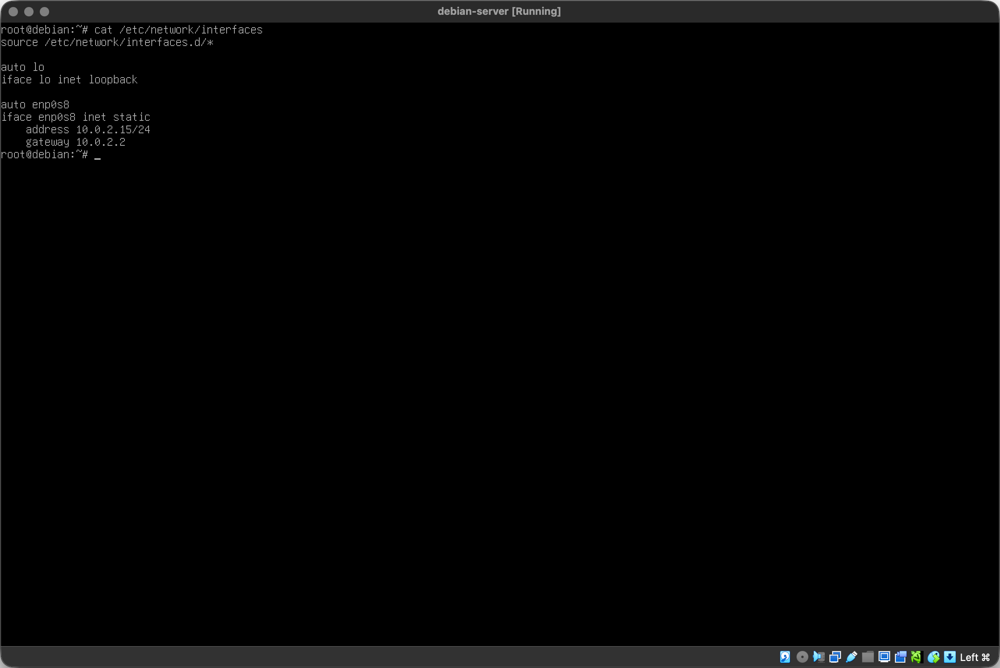

### 3.3. Проверка

```bash
ip a show enp0s8      # inet 10.0.2.15/24 без пометки dynamic — адрес статический
ifconfig              # то же через утилиту из net-tools
ip route              # default via 10.0.2.2 dev enp0s8
ping -c 3 10.0.2.2    # шлюз
ping -c 3 debian.org  # интернет и DNS
```

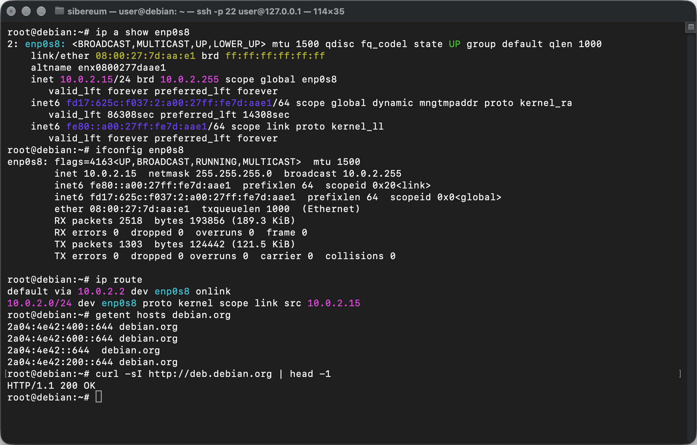

---

## 4. Диагностика сетевых проблем

```bash
sudo apt install -y traceroute
```

| Команда      | Назначение                                                                                                                        | Примеры                                                          |
| ------------ | --------------------------------------------------------------------------------------------------------------------------------- | ---------------------------------------------------------------- |
| `traceroute` | показывает маршрутизаторы на пути до узла и задержку на каждом шаге; основан на увеличении TTL пакетов; `* * *` — узел не ответил | `traceroute -n 8.8.8.8`, `sudo traceroute -T -p 443 ya.ru` (TCP) |
| `netstat`    | устаревшая утилита (net-tools): соединения, слушающие порты, таблица маршрутов                                                    | `sudo netstat -tulpn`, `netstat -rn`                             |
| `ss`         | современная замена netstat: получает данные напрямую из ядра, работает быстрее, поддерживает фильтры                              | `sudo ss -tulpn`, `ss -tn state established`, `ss -s`            |

Флаги `-tulpn`: `t` — TCP, `u` — UDP, `l` — только слушающие сокеты, `p` — процесс, `n` — числовые адреса и порты.

```bash
traceroute -n 8.8.8.8
sudo traceroute -T -p 443 ya.ru
```

В режиме NAT VirtualBox часть узлов отвечает `* * *` — промежуточные маршрутизаторы не отвечают на служебные пакеты; TCP-вариант проходит лучше.

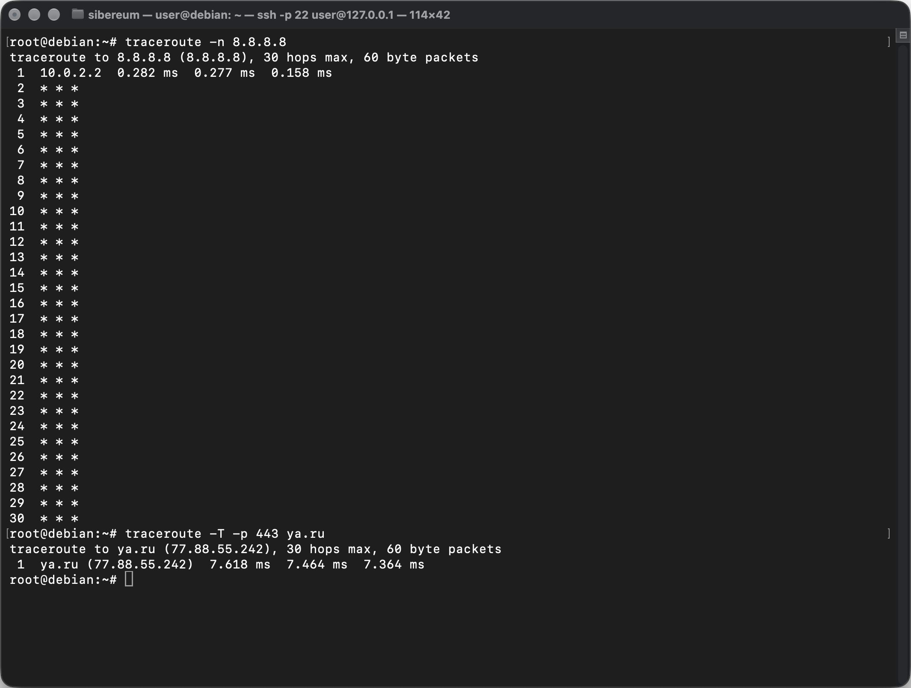

```bash
sudo netstat -tulpn
netstat -rn
```

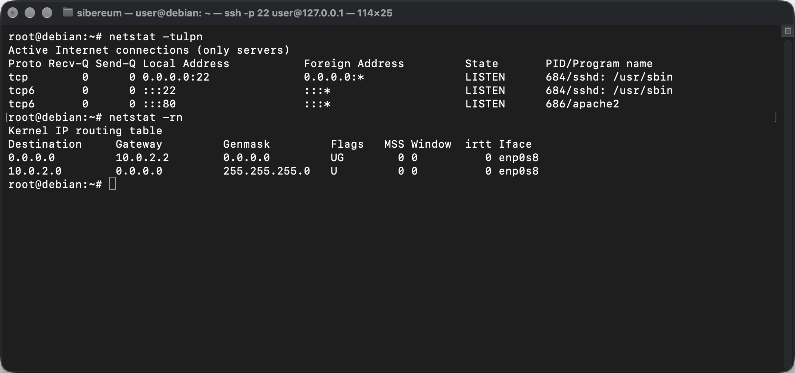

```bash
sudo ss -tulpn
ss -tn state established
ss -s
```

Видно, что порт 22 слушает `sshd`, порт 80 — `apache2`; среди активных соединений — SSH-сессия с Mac.

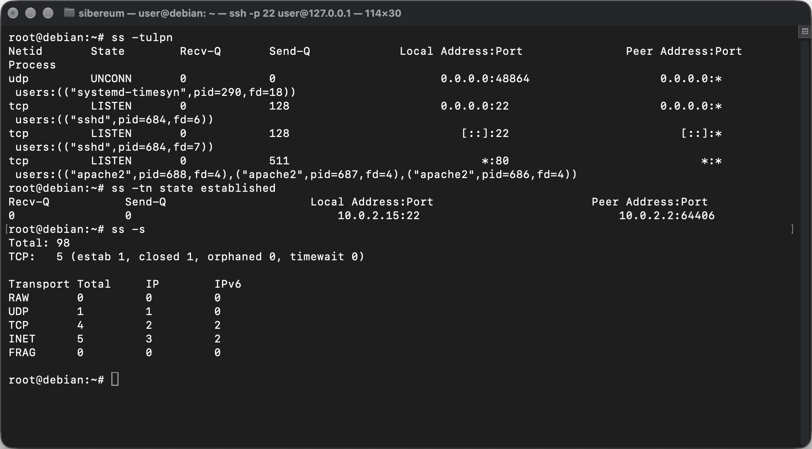

Пример последовательности диагностики «сайт не открывается»: `systemctl status apache2` (служба запущена?) → `ss -tlnp | grep :80` (порт слушается?) → `curl -I localhost` (сервер отвечает локально?) → `ping` / `traceroute` (есть ли связь с клиентом).

---

## Вывод

Настроен `/etc/apt/sources.list` с официальными репозиториями Debian и зеркалом, установлены пакеты vim, curl, net-tools, apache2, в том числе с помощью bash-скрипта. С помощью `systemctl` настроен автозапуск Apache и SSH, изучены команды запуска, остановки и проверки состояния служб; через cron настроен ежедневный перезапуск Apache. Для интерфейса `enp0s8` настроен статический IP-адрес `10.0.2.15/24` со шлюзом `10.0.2.2` через `/etc/network/interfaces`, конфигурация проверена командами `ip`, `ifconfig`, `ping`. Изучены утилиты диагностики сети `traceroute`, `netstat` и `ss`.
