# Лабораторная работа № 4. Безопасность системы и файловые системы

ФИО студента: _______________________  
Группа: ________

## Цель работы

Настроить файрвол UFW, автоматические обновления безопасности и fail2ban. Подключить новый диск, настроить его автоматическое монтирование и сделать оповещение о заполнении диска.

Все команды выполнялись от имени root.

---

## Задание 1. Настройка файрвола UFW

Устанавливаем UFW и разрешаем только SSH, HTTP и HTTPS:

```bash
apt install ufw
ufw allow ssh
ufw allow http
ufw allow https
ufw enable
```

Сначала разрешаем SSH, потом включаем файрвол, иначе подключение по SSH оборвётся.

Проверка:

```bash
ufw status
```

Файрвол включён, открыты только порты 22 (SSH), 80 (HTTP) и 443 (HTTPS). Остальные входящие подключения запрещены.

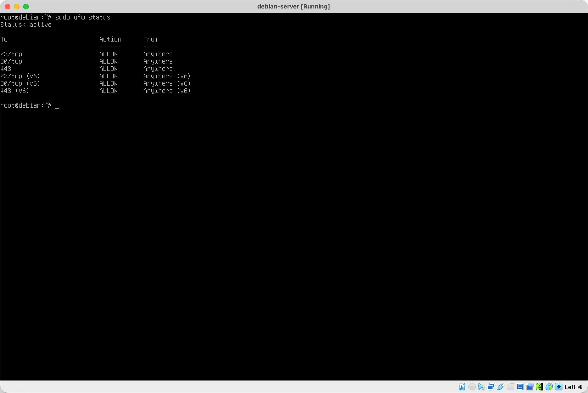

UFW записывает правила в iptables. Проверка:

```bash
iptables -L -n
```

В цепочке `ufw-user-input` видны разрешающие правила для портов 22, 80 и 443.

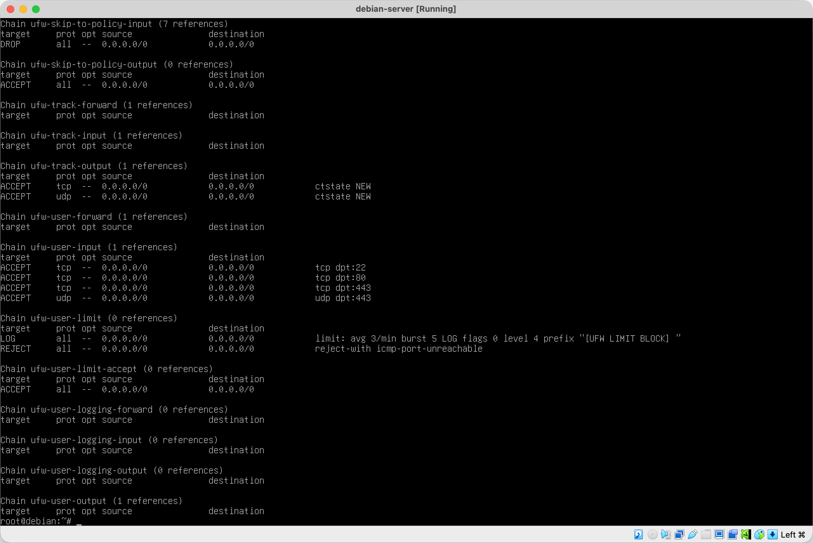

---

## Задание 2. Обеспечение безопасности системы

### Автоматические обновления безопасности

```bash
apt install unattended-upgrades
dpkg-reconfigure unattended-upgrades
```

В появившемся окне выбрано **Yes**.

Проверка:

```bash
cat /etc/apt/apt.conf.d/20auto-upgrades
```

`"1"` означает, что каждый день обновляется список пакетов и устанавливаются обновления безопасности.

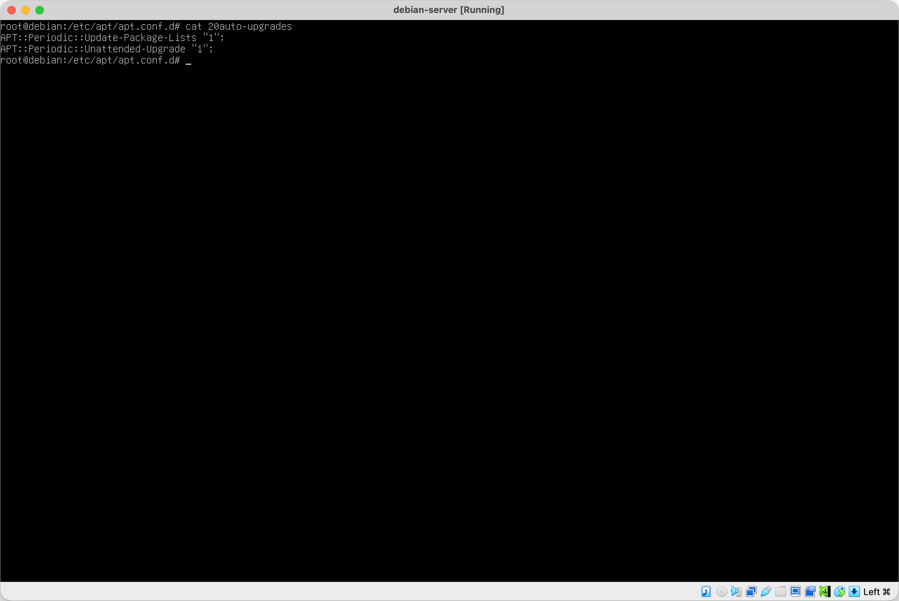

### fail2ban

fail2ban защищает от подбора паролей: если с одного IP много неудачных входов по SSH, этот IP блокируется.

```bash
apt install fail2ban python3-systemd
nano /etc/fail2ban/jail.local
```

Содержимое `/etc/fail2ban/jail.local`:

```
[sshd]
enabled = true
backend = systemd
```

`backend = systemd` нужен потому, что в Debian 13 логи входов хранятся в журнале systemd.

```bash
systemctl restart fail2ban
fail2ban-client status sshd
```

Защита SSH работает, заблокированных адресов пока нет.

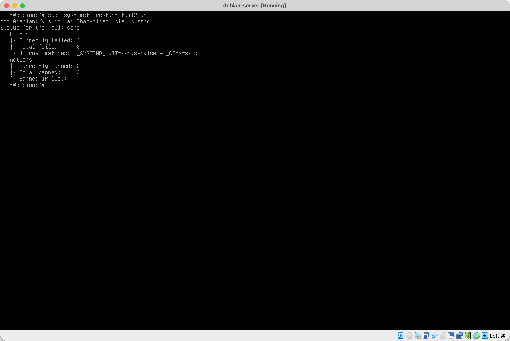

---

## Задание 3. Управление файловыми системами

### Создание диска

При выключенной ВМ в VirtualBox (Настроить → Носители) добавлен новый диск размером 1 ГБ.

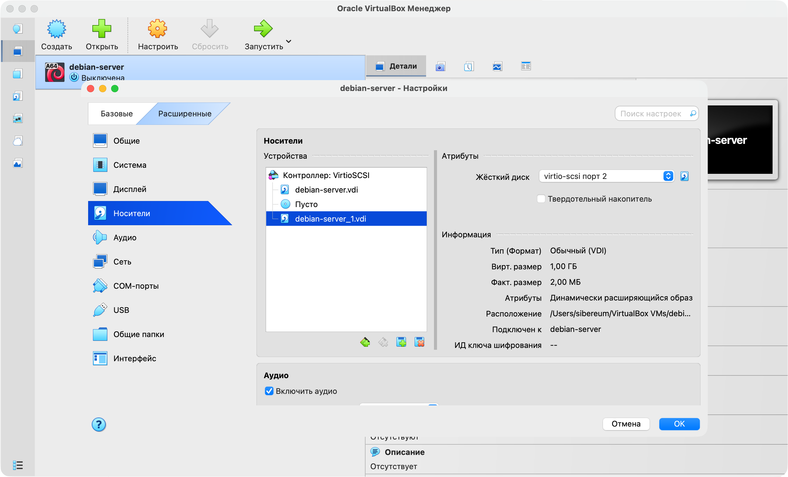

После запуска система видит его как `sdb`:

```bash
lsblk
```

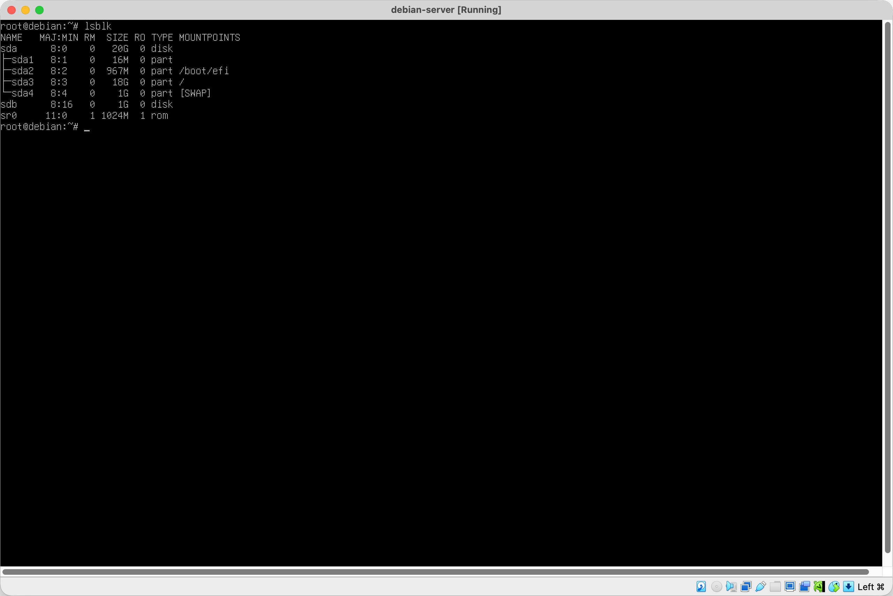

### Форматирование и монтирование

```bash
mkfs.ext4 /dev/sdb
mkdir /mnt/storage
mount /dev/sdb /mnt/storage
df -h
```

Диск отформатирован в ext4 и подключён к папке `/mnt/storage`.

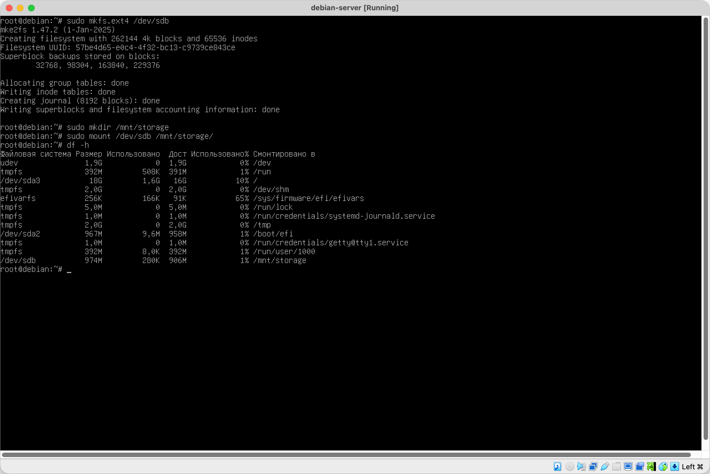

### Автоматическое монтирование

В конец файла `/etc/fstab` добавлена строка:

```
/dev/sdb  /mnt/storage  ext4  defaults  0  0
```

Это диск, папка, файловая система, параметры по умолчанию; два нуля — без резервного копирования и без проверки диска при загрузке.

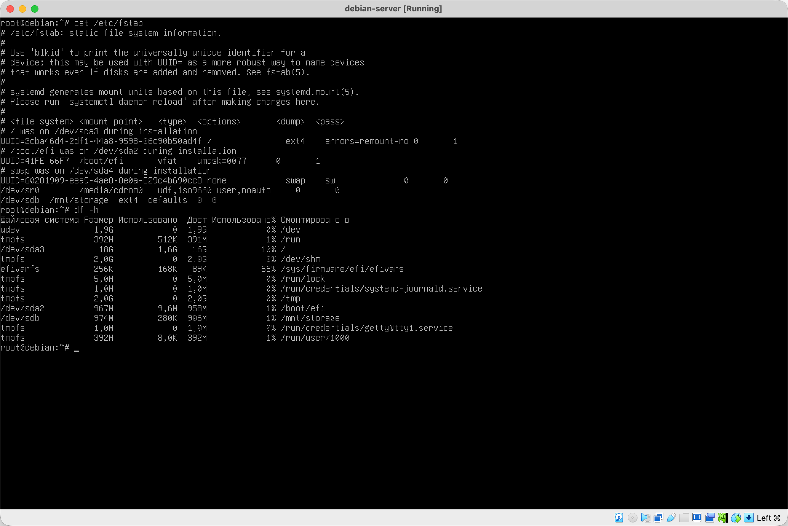

После перезагрузки диск подключился автоматически:

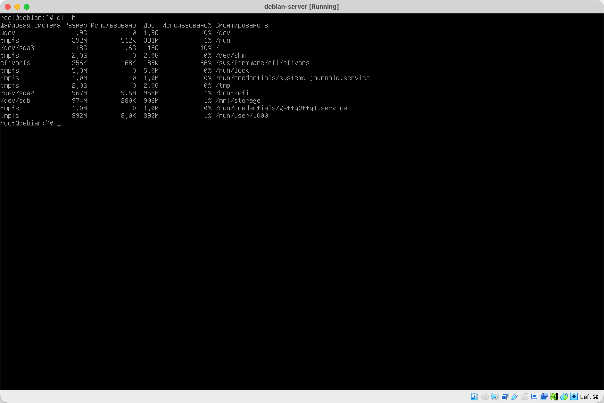

---

## Задание 4. Мониторинг дискового пространства

### du — размер папок

```bash
du -sh /home/*
```

`-s` — только итог по папке, `-h` — в понятных единицах (K, M, G).

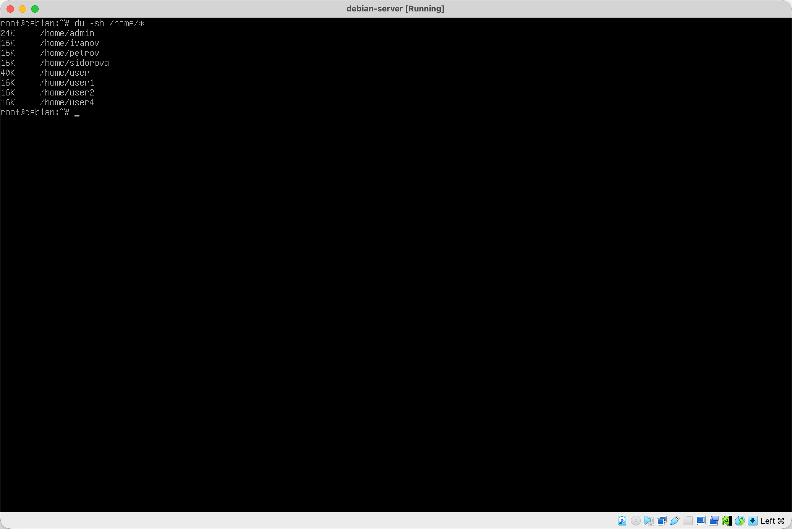

### df — свободное место на дисках

`df -h` показан выше: размер, занято, свободно и процент заполнения каждого диска.

### lsblk — диски и разделы

```bash
lsblk
```

Видно, что `sdb` смонтирован в `/mnt/storage`.

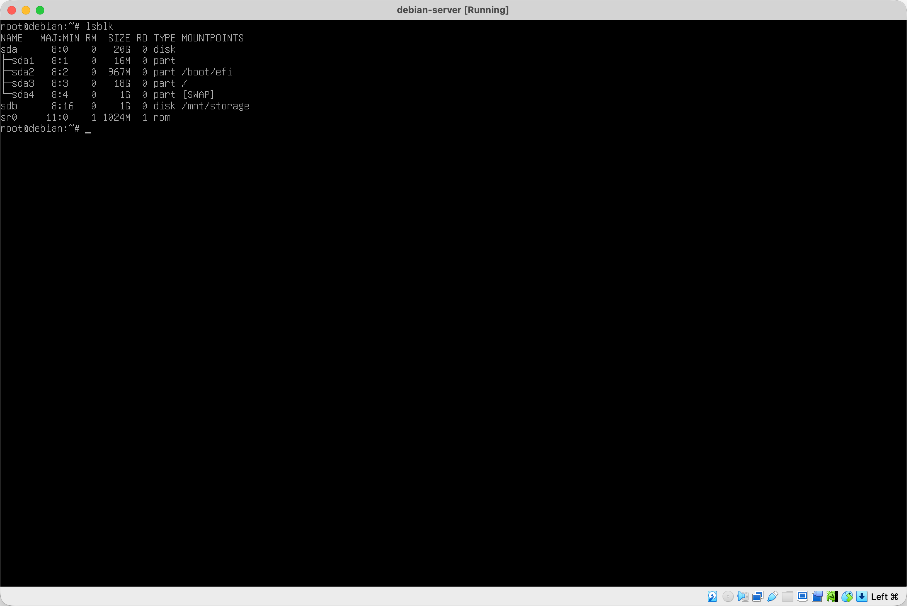

### fdisk — подробная информация о дисках

```bash
fdisk -l
```

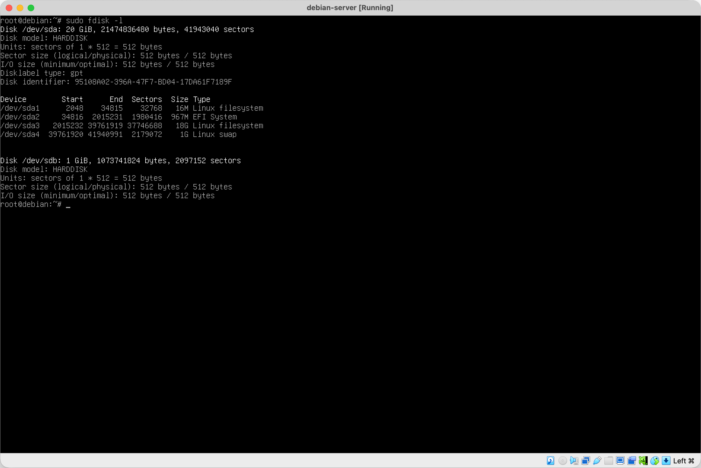

### Оповещение при заполнении 80%

Скрипт `/root/disk_check.sh`:

```bash
#!/bin/bash
# Проверка заполненности диска
LIMIT=80
USAGE=$(df / | tail -1 | awk '{print $5}' | tr -d '%')

if [ "$USAGE" -ge "$LIMIT" ]; then
    echo "$(date) Диск заполнен на $USAGE%" >> /var/log/disk_alert.log
    wall "Диск заполнен на $USAGE%"
fi
```

Скрипт берёт из `df /` процент заполнения диска и сравнивает его с 80. Если больше или равно, делает запись в `/var/log/disk_alert.log` и выводит сообщение всем пользователям через `wall`.

Проверка: диск заполнен на 10%, поэтому для теста порог временно был поставлен 5. Сообщение появилось и записалось в лог. После проверки порог возвращён на 80.

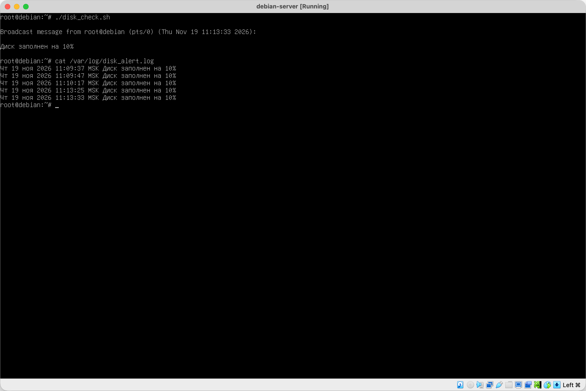

Скрипт добавлен в cron, проверка выполняется каждый час:

```bash
crontab -e
```

```
0 * * * * /root/disk_check.sh
```

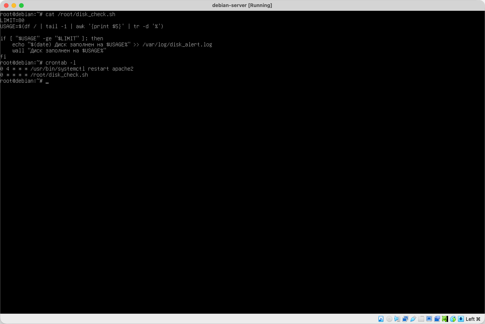

---

## Вывод

Настроен файрвол UFW: открыты только SSH, HTTP и HTTPS. Включены автоматические обновления безопасности, установлен fail2ban для защиты SSH от подбора паролей. Подключён новый диск 1 ГБ, отформатирован в ext4, смонтирован в `/mnt/storage` и подключается автоматически при загрузке. Изучены команды `du`, `df`, `lsblk`, `fdisk`, настроено оповещение при заполнении диска на 80% (скрипт + cron).
